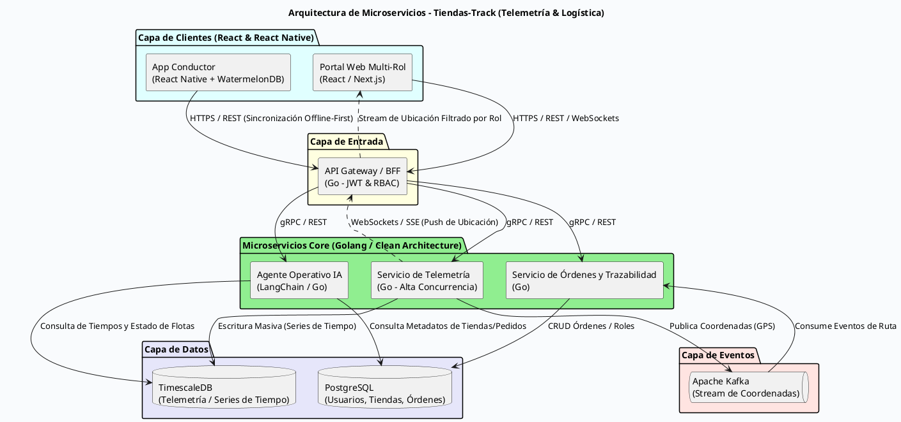

A continuación, te presento el diseño de la arquitectura orientada a microservicios para el sistema de telemetría y trazabilidad multi-rol (**Tiendas-Track**). Este diseño cumple con los requerimientos de la prueba técnica (alta concurrencia, eventos, persistencia especializada) y sirve como un módulo desacoplado integrable en tu plataforma de tiendas.

### Diagrama de Arquitectura (PlantUML)

Puedes copiar este código y visualizarlo en cualquier visor de PlantUML (como PlantText, el plugin de VS Code o Mermaid/PlantUML online):

---

### Descripción de Componentes y Tecnologías Utilizadas

* **1. Capa de Frontend y Mobile (React / React Native):**
* **Portal Web (`@tiendas/tracking-ui`):** Diseñado como una librería modular de React para que cualquier otro sistema de la plataforma lo importe. Renderiza mapas interactivos y se conecta a WebSockets filtrando la información según el rol (`Proveedor`, `Tendero`, `Cliente`).
* **App Móvil del Conductor:** Desarrollada en **React Native** con persistencia local basada en **SQLite/WatermelonDB** para garantizar el funcionamiento *Offline-First* (captura coordenadas sin internet y hace *Bulk Sync* al reconectar).

* **2. API Gateway / BFF (Backend For Frontend):**
* Construido en **Golang**. Se encarga de la validación de tokens JWT, control de acceso basado en roles (**RBAC**) para aislar la visualización de flotas, y manejo de WebSockets/SSE para despachar la ubicación en tiempo real al navegador.

* **3. Microservicios Backend (Go - Clean Architecture):**
* **Servicio de Telemetría:** Optimizado en Go para la ingesta masiva y de alta concurrencia de eventos de geolocalización provenientes de los dispositivos o la app móvil.
* **Servicio de Órdenes y Trazabilidad:** Administra el ciclo de vida de los pedidos (del proveedor al tendero, y del tendero al cliente final) asociándolos a flotas de transporte específicas.
* **Agente Operativo de IA:** Integrado en el ecosistema para procesar lenguaje natural (ej. consultar por chat qué vehículos llevan más de 20 minutos detenidos), conectándose directamente a las bases de datos analíticas.

* **4. Bus de Eventos y Persistencia:**
* **Apache Kafka:** Desacopla la ingesta masiva de coordenadas GPS para evitar cuellos de botella en la base de datos.

* **TimescaleDB:** Base de datos relacional optimizada para series de tiempo, ideal para almacenar millones de registros de telemetría vehicular de alta frecuencia con consultas espaciales eficientes.

* **PostgreSQL:** Almacena los datos relacionales tradicionales del negocio (usuarios, tiendas de barrio, catálogos de productos y asignación de órdenes).