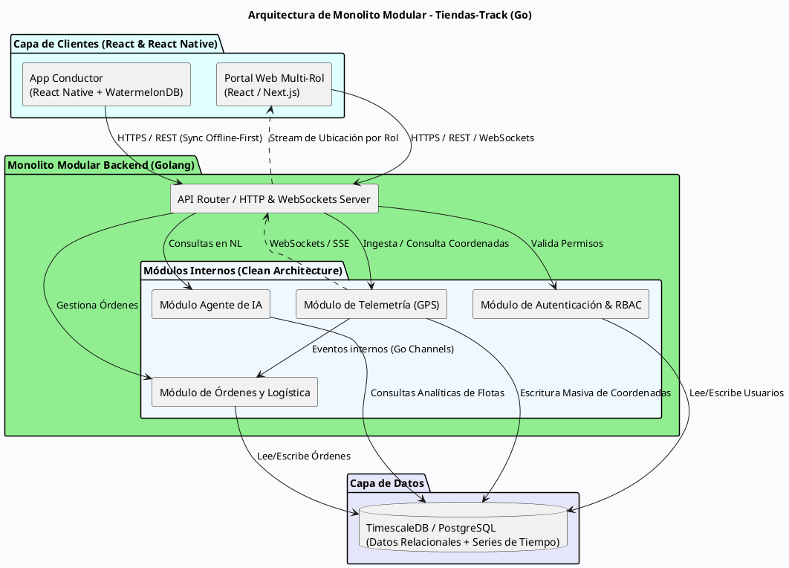

Es una decisión **excelente y muy pragmática**. Comenzar con un **Monolito Modular** en Go te da lo mejor de dos mundos: mantienes una separación estricta de responsabilidades (preparando el terreno para migrar a microservicios en el futuro cuando el volumen lo exija) pero eliminas la complejidad operativa, la latencia de red entre servicios y los costos excesivos de infraestructura en esta primera fase.

Además, para una prueba técnica y un MVP de producto, te permite entregar resultados mucho más rápido sin volverte loco configurando Kubernetes, redes Docker complejas o brokers de mensajes pesados desde el día uno.

A continuación, te muestro cómo se estructura la arquitectura de un **Monolito Modular en Go** y su respectivo diagrama en PlantUML.

---

### ¿Cómo se estructura un Monolito Modular en Go?

Bajo los principios de **Clean Architecture y Domain-Driven Design (DDD)**, el código se divide en paquetes internos independientes (`internal/modules/...`) donde cada módulo tiene su propio dominio, casos de uso y repositorios, comunicándose entre sí mediante interfaces limpias y no mediante llamadas HTTP o gRPC externas:

* **`internal/auth`**: Gestión de usuarios, tokens JWT y reglas de control de acceso por roles (**RBAC** para Proveedor, Tendero y Cliente).
* **`internal/orders`**: Gestión de pedidos y ciclo de vida de la trazabilidad (del proveedor al tendero, y del tendero al cliente final).
* **`internal/telemetry`**: Ingesta de coordenadas GPS, manejo de WebSockets/SSE para tiempo real y conexión con la base de datos de series de tiempo.
* **`internal/aiagent`**: El agente operativo capaz de consultar el estado de las flotas en lenguaje natural.

---

### Diagrama de Arquitectura (Monolito Modular en PlantUML)

---

### Ventajas clave de este enfoque para tu caso:

1. **Desarrollo Acelerado (Ideal para la prueba de 8-12 horas):** No necesitas levantar un clúster de Kafka ni múltiples contenedores de microservicios. Con una sola instancia de Go y Docker Compose levantando Go + TimescaleDB/PostgreSQL tienes todo funcionando en segundos.
2. **Satisfaces los requerimientos de la prueba:** La prueba exige Clean Architecture y manejo de eventos. En Go puedes simular un bus de eventos interno usando **Go Channels** o un dispatcher síncrono/asíncrono en memoria, lo cual demuestra diseño limpio sin la sobrecarga de infraestructura distribuida.

3. **Fácil transición a Microservicios:** Como los módulos (`telemetry`, `orders`, `auth`) están completamente aislados por carpetas e interfaces dentro del monolito, el día de mañana que las tiendas crezcan masivamente y necesites separar el servicio de telemetría, solo debes extraer esa carpeta a su propio repositorio y levantarle un gRPC/Kafka enfrente, sin reescribir la lógica de negocio.