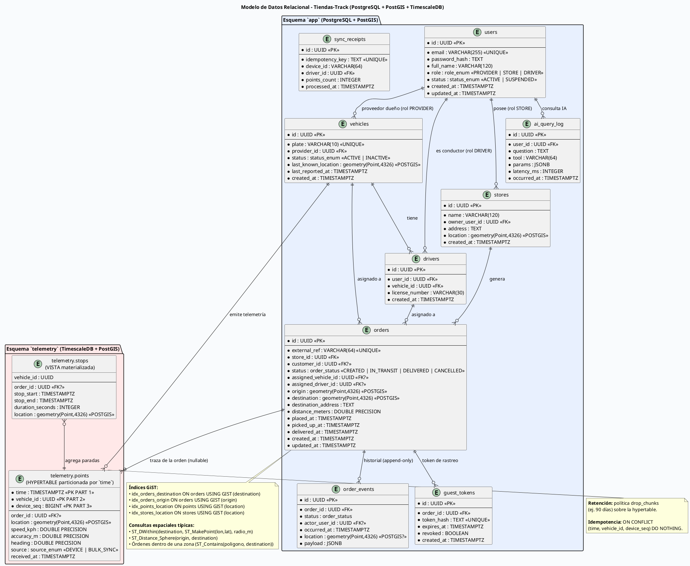

# Base de Datos Relacional — Tiendas-Track (PostgreSQL + PostGIS + TimescaleDB)

- **Versión:** 1.0
- **Fecha:** 2026-10-27
- **Estado:** Propuesta pendiente de aprobación
- **Diagrama fuente:** `modelo_datos.puml` · **Render:** `modelo_datos.png`



---

## 1. Decisiones de Diseño

### 1.1 Una sola instancia PostgreSQL con TimescaleDB y PostGIS

| Componente | Rol |
|---|---|
| **PostgreSQL** | Sistema de registros: usuarios, tiendas, vehículos, órdenes, eventos. |
| **TimescaleDB** | Extensión para la hypertable de telemetría de alta frecuencia (`telemetry.points`). |
| **PostGIS** | Extensión para **todo lo geográfico**: coordenadas de destino de órdenes, ubicación de tiendas, trazas y paradas. |

TimescaleDB y PostGIS conviven sin conflicto: la hypertable soporta columnas `geometry` e índices GiST. Se usa un **único contenedor** de base de datos (ADR-02 del plan de desarrollo) para simplificar transacciones y el entorno Docker.

### 1.2 PostGIS como estándar de coordenadas

Todas las coordenadas se almacenan como **`geometry(Point, 4326)`** (SRID 4326 = WGS84, el estándar de GPS). Nunca se guardan `lat`/`lon` sueltas en columnas `DOUBLE` cuando existen consultas espaciales.

**Tipos geográficos del modelo:**

| Tabla | Columna geográfica | Uso |
|---|---|---|
| `orders` | `origin` | Punto de recogida / salida de la orden. |
| `orders` | **`destination`** | **Punto exacto donde debe llegar la orden (requerimiento del usuario).** |
| `stores` | `location` | Ubicación de la tienda de barrio (geocercas, "flota que me surte"). |
| `vehicles` | `last_known_location` | Última posición conocida (cache de lectura rápida). |
| `telemetry.points` | `location` | Cada punto GPS de la traza. |
| `telemetry.stops` | `location` | Centro de cada parada detectada. |
| `order_events` | `location` (nullable) | Ubicación en el momento del evento (ej. entrega). |

**Ventajas de PostGIS frente a lat/lon simples:**
- `ST_DWithin(...)` con índice GiST → "órdenes a menos de 500 m de un punto" **sin escanear la tabla**.
- `ST_Distance_Sphere(origin, destination)` → distancia real en metros.
- `ST_Contains(poligono, destination)` → órdenes dentro de una zona de cobertura.
- Cálculo de llegada/ETA y detección de "detenidos en zona" del agente IA con geometrías, no con `sqrt` casero.

### 1.3 Índices GiST (obligatorios)

```sql
CREATE INDEX idx_orders_destination ON orders USING GIST (destination);
CREATE INDEX idx_orders_origin      ON orders USING GIST (origin);
CREATE INDEX idx_stores_location    ON stores  USING GIST (location);
CREATE INDEX idx_points_location    ON telemetry.points USING GIST (location);
```

### 1.4 Ejemplos de consultas espaciales

```sql
-- Órdenes cuyo destino está a menos de 500 m de un punto
SELECT id, external_ref, status
FROM orders
WHERE ST_DWithin(destination, ST_SetSRID(ST_MakePoint(-74.0721, 4.7104), 4326), 500 * 1.0 / 111320);

-- Distancia real de la ruta planificada
SELECT id, ST_Distance_Sphere(origin, destination) AS distancia_m
FROM orders WHERE id = :order_id;

-- Vehículos cerca del destino de una orden (ETA)
SELECT v.id, v.plate,
       ST_Distance_Sphere(v.last_known_location, o.destination) AS metros_al_destino
FROM vehicles v, orders o
WHERE o.id = :order_id AND v.id = o.assigned_vehicle_id;

-- Órdenes dentro de una zona de cobertura (geocerca)
SELECT id FROM orders WHERE ST_Contains(:zona::geography::geometry, destination);
```

> **Nota de unidades:** con SRID 4326, `ST_DWithin` trabaja en grados. Para radios en metros se envuelve en `geography` (`ST_DWithin(destination::geography, punto::geography, metros)`) o se divide el radio por ~111 320. Se recomienda **`::geography`** para claridad.

---

## 2. Esquema `app` (PostgreSQL)

### 2.1 Tablas y relaciones

| Tabla | Clave | Relación |
|---|---|---|
| `users` | PK `id` | Un usuario con rol `PROVIDER`, `STORE` o `DRIVER`. |
| `stores` | PK `id`, FK `owner_user_id → users` | Una tienda es poseída por un usuario (rol STORE). |
| `vehicles` | PK `id`, FK `provider_id → users` | Vehículo de la flota de un proveedor. |
| `drivers` | PK `id`, FK `user_id → users`, FK `vehicle_id → vehicles` | Conductor vinculado a un vehículo. |
| `orders` | PK `id`, FK `store_id`, `assigned_vehicle_id?`, `assigned_driver_id?`, `customer_id?` | Orden con `origin` y **`destination` (PostGIS)**. |
| `order_events` | PK `id`, FK `order_id → orders` | Historial append-only de transiciones. |
| `guest_tokens` | PK `id`, FK `order_id → orders` | Token de invitado para que el Cliente Final rastree su orden. |
| `sync_receipts` | PK `id`, `idempotency_key` UNIQUE | Control de duplicados del Bulk Sync offline. |
| `ai_query_log` | PK `id`, FK `user_id → users` | Auditoría de cada consulta al agente IA. |

### 2.2 Detalle de `orders` (tabla central)

| Columna | Tipo | Descripción |
|---|---|---|
| `id` | UUID PK | Identificador interno. |
| `external_ref` | VARCHAR(64) UNIQUE | Referencia del sistema del proveedor (idempotencia). |
| `store_id` | UUID FK → `stores` | Tienda que genera/recibe la orden. |
| `customer_id` | UUID FK → `users` NULLABLE | Cliente final si está registrado. |
| `status` | `order_status` | `CREATED`, `IN_TRANSIT`, `DELIVERED`, `CANCELLED`. |
| `assigned_vehicle_id` | UUID FK → `vehicles` NULLABLE | Vehículo asignado (RF-06). |
| `assigned_driver_id` | UUID FK → `drivers` NULLABLE | Conductor asignado (RF-06). |
| **`origin`** | **geometry(Point,4326)** | Punto de salida. |
| **`destination`** | **geometry(Point,4326)** | **Destino requerido de la orden.** |
| `destination_address` | TEXT | Dirección legible complementaria. |
| `distance_meters` | DOUBLE PRECISION | Distancia calculada al crear (informativo; la fuente de verdad es PostGIS). |
| `placed_at` / `picked_up_at` / `delivered_at` | TIMESTAMPTZ | Hitos del ciclo de vida. |
| `created_at` / `updated_at` | TIMESTAMPTZ | Auditoría. |

**Restricciones:**
- `CHECK (origin IS NOT NULL AND destination IS NOT NULL)`.
- `ST_IsValid(destination) = true` (trigger o `CHECK` con función).
- Transiciones de `status` validadas en la capa de dominio (RF-05).

---

## 3. Esquema `telemetry` (TimescaleDB + PostGIS)

| Objeto | Definición |
|---|---|
| `telemetry.points` | **Hypertable** particionada por `time`. PK compuesta `(time, vehicle_id, device_seq)` para tolerar duplicados. Columna `location geometry(Point,4326)` con índice GiST. FK lógica a `vehicles` y `orders` (sin restricción física por desempeño en ingestas masivas). |
| `telemetry.stops` | Vista/agregado de paradas (vehículo detenido > N minutos) que alimenta al agente IA (`get_stopped_vehicles`). |
| Retención | Política `drop_chunks` configurable (ej. 90 días). |

**Idempotencia:** `INSERT ... ON CONFLICT (time, vehicle_id, device_seq) DO NOTHING` para que el Bulk Sync pueda reintentarse sin duplicar (RF-09 / RNF-06).

---

## 4. Migraciones y extensión

Las migraciones (golang-migrate o Atlas) deben ejecutar en este orden:

```sql
CREATE EXTENSION IF NOT EXISTS postgis;
CREATE EXTENSION IF NOT EXISTS timescaledb;
-- después: CREATE SCHEMA app; CREATE SCHEMA telemetry;
-- hypertable: SELECT create_hypertable('telemetry.points', 'time');
```

El arranque está orquestado por Docker Compose (F1 del plan de desarrollo).

---

## 5. Trazabilidad con el plan de desarrollo

| Requerimiento | Elemento del modelo |
|---|---|
| RF-05 (ciclo de vida) | `orders.status` + `order_events` |
| RF-06 (asociación de flota) | `orders.assigned_vehicle_id`, `orders.assigned_driver_id` |
| RF-03 (ingesta GPS) | `telemetry.points` |
| RF-08/09 (offline + bulk sync) | `sync_receipts.idempotency_key` |
| RF-10 (agente IA) | `telemetry.stops` + `ai_query_log` |
| **Destino de la orden (PostGIS)** | **`orders.destination` + índices GiST** |

---

## 6. Preguntas pendientes

1. **Geocodificación:** ¿quién convierte `destination_address` → coordenadas? Opciones: geocoding en el cliente, al crear la orden en el backend (proveedor externo) o ambas. *Pendiente de decisión.*
2. **Formato de entrada:** ¿el cliente envía `lat/lon` o dirección? Se recomienda aceptar ambas y persistir siempre la geometría.
3. **SRID de trabajo:** se asume WGS84 (4326). Si los datos del proveedor vienen en otro SRID, convertir con `ST_Transform` en la frontera de entrada.
