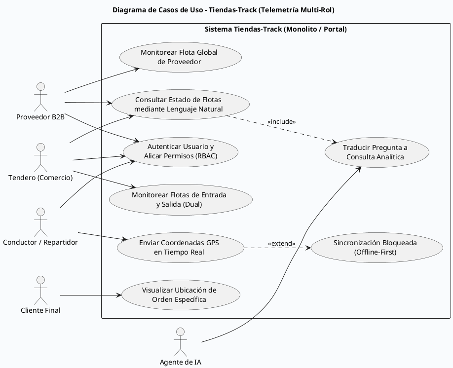

A continuación, te presento el **Diagrama de Casos de Uso** en PlantUML para el sistema **Tiendas-Track** (Logística, Trazabilidad y Telemetría Multi-Rol).

Siguiendo las **buenas prácticas de UML**:

1. **Delimitación clara del sistema:** Se utiliza un rectángulo (`rectangle`) para definir los límites de la plataforma.
2. **Definición precisa de actores:** Se identifican los roles del ecosistema (Proveedor, Tendero, Cliente Final, Conductor) y el Agente de IA.
3. **Nombrado correcto de casos de uso:** Se estructuran con verbos en infinitivo + objeto (ej. *Monitorear Flota*, *Enviar Telemetría*).
4. **Relaciones lógicas:** Uso de asociaciones directas y relaciones de extensión/inclusión (`<<include>>` / `<<extend>>`) donde aplique.

### Código PlantUML

Puedes copiar este código y visualizarlo en cualquier renderizador de PlantUML (como PlantText, VS Code, etc.):

---

### Descripción de los Elementos Clave:

1. **Actores y Aislamiento (RBAC):**
* **Proveedor:** Accede a la vista global de su flota de distribución hacia las tiendas.
* **Tendero:** Posee una vista dual (ve la flota que le surte y la flota que reparte a sus clientes).
* **Cliente Final:** Cuenta con un caso de uso acotado exclusivamente a rastrear la orden única que le pertenece.
* **Conductor:** Interactúa desde la aplicación móvil ejecutando el flujo *Offline-First*.

2. **Relaciones de Dependencia (`<<extend>>` y `<<include>>`):**
* El envío de GPS del conductor (`UC_SendGPS`) puede disparar de forma opcional la sincronización masiva si estuvo offline (`UC_SyncOffline`).

* La consulta al agente de IA (`UC_AIAgent`) incluye obligatoriamente el procesamiento de lenguaje natural (`UC_ProcessNLP`) para consultar las bases de datos de series de tiempo.